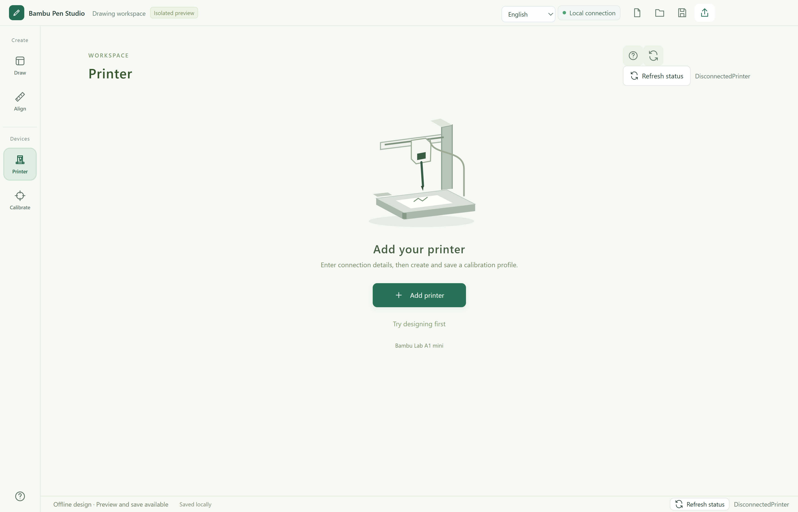

# Bambu Pen

Settings: use the lower-left Settings icon or Ctrl+, for Light / Dark / System themes, Chinese / English, updates, local files and version information. Existing user data stays in `%USERPROFILE%\.a1-pen-studio`.

设置入口：左下角设置图标，或 Ctrl+,。支持浅色、深色、跟随系统、中英文、软件更新、数据文件夹和版本信息。改名后继续使用原数据目录。

A local desktop workspace for pen drawing with Bambu Lab printers. Community project, not an official Bambu Lab product.

拓竹写字机是把文字与图像转换为纸面绘画路径的本地桌面工具，非拓竹官方产品。



## Features / 功能

- Chinese and English interface, text and single-line fonts / 中英双语、单线文字
- Paper layout, drag/resize/rotate, context menu and 2D/3D preview / 纸张排版、右键编辑与路径预演
- Image contours, hatching, sketch paths and local eraser / 图片转轮廓、排线、素描与橡皮擦
- Named calibration profiles, nib width and mount offsets / 校准配置、笔芯线宽与笔架偏移
- Local printer connection, status refresh, full-file and streamed drawing / 局域网连接、整图与分段任务
- In-app update checks, verified downloads and persistent local data / 软件内检查更新、校验下载、保留本机数据
- Error guidance and reviewed problem reports / 错误分类建议、脱敏报告预览与导出

Problem reports: **Settings → Feedback**. Anonymous GitHub submission requires a separately configured server; this build offers Copy / Export until that service is enabled. No reports upload automatically. See [setup and privacy / 配置与隐私](docs/FEEDBACK.txt).

问题报告位于 **设置 → 问题反馈**。匿名提交到 GitHub 需要另行启用中转服务；未配置服务时可复制、导出，不会自动上传。

## Download & updates / 下载与更新

[Download the latest Windows EXE / 下载最新 Windows 程序](https://github.com/Shangyuwang11/bambu-pen-studio/releases/latest).

Open **Settings → Updates & data** in the lower-left corner. Automatic checks notify you; download and restart only when you choose. Drawing and calibration block installation. Projects and settings are backed up before updating and remain in the same user directory. Older builds need one manual upgrade to enable this feature.

左下角 **设置 → 更新与数据** 可以检查和下载新版本；自动检查只提示，不会自行重启。绘画与校准时不能安装更新。更新前保存作品、备份配置，继续使用原数据目录。旧版本首次需要手动换到带更新功能的 EXE。

See [publishing and storage details / 发布步骤与数据说明](docs/UPDATES.txt).

## Support / 支持范围

Version 0.22.0 targets Windows 10/11 x64. **A1 mini, A1 and P1S** support LAN connection, calibration, streamed drawing and full-file upload. **A1 / P1S support is experimental and has not been tested on physical hardware.** Model detection, motion bounds, task packaging and simulated workflows are tested. Preview is a simulation, not a position sensor. See [model support and references](docs/MODEL-SUPPORT.txt).

0.22.0 支持 A1 mini、A1、P1S 的局域网连接、校准、分段绘画与整图上传。**A1 / P1S 为实验性适配，已完成代码与模拟流程测试，尚未实机验证。** 画布与校准配置必须匹配实际机型；连接页可一键切换画布。P1S 绘画避开左侧 18 mm，Z 上限 250 mm。预览不是机器位置传感器。

## Run from source / 从源码运行

Install Node.js 22 or newer, then:

```sh
npm install
npm start
```

To run the local browser workspace without installing Electron: `node bridge/server.cjs`, then open `http://127.0.0.1:8765`. The packaged EXE uses a native desktop window.

无需 Electron 的浏览器开发模式：运行 `node bridge/server.cjs`，访问 `http://127.0.0.1:8765`。正式 EXE 使用独立桌面窗口。

## Build Windows EXE / 构建 EXE

Install PowerShell 7 and run after `npm install`:

```powershell
pwsh -NoProfile -File scripts/build-windows.ps1
# Or supply an extracted official Electron Windows x64 runtime:
pwsh -NoProfile -File scripts/build-windows.ps1 -ElectronRuntime C:/path/to/electron
```

The output is `dist/Bambu-Pen-Studio-VERSION-win-x64.exe`. Electron 44.4.5 is pinned to match this release. Runtime licenses are retained. The output is unsigned.

## Test / 测试

```sh
npx playwright install chromium
node scripts/test.cjs
```

Tests use synthetic printer state and temporary credential records; they do not connect to physical hardware. This release checks machine identity, model-specific limits, calibration, repeated tasks, full-file metadata, pairing persistence and actual UI interactions with mock printers. No physical printer is operated by these tests.

测试使用模拟打印机与测试凭据，不操作实机。本版检查了机型识别、运动范围、校准、连续任务、完整任务包、连接资料保存和真实界面交互；本轮不操作实体打印机。

## Getting started / 开始使用

Open Printer, add your own LAN IP, serial and access code, then use the Calibrate page. Remove the pen and paper when the homing step asks you to. Save a profile, arrange the artwork, preview, and send. The in-app Help includes a full Chinese/English guide.

先在打印机页添加自己的设备，再按校准页向导完成校准并保存配置。需要归零时按提示取下纸笔。然后排版、预览并发送。完整双语说明在应用帮助中。

## Privacy / 隐私

No real printer credentials, private drawings or user backups are included. Local data lives in `~/.a1-pen-studio`, independently of application versions. Do not upload that directory or unredacted diagnostic files.

仓库不含真实打印机凭据、私人作品或备份。本机数据保存在 `~/.a1-pen-studio`，与软件版本分离；不要上传该目录或未经脱敏的诊断文件。

## Third-party material / 第三方材料

See [asset notices](assets/NOTICE.md), [plate model licenses and original sources](assets/plates/NOTICE.md), and [runtime notices](desktop/NOTICE.md). These retain their respective licenses. Publishing application source does not change those licenses. No additional license for the original application code has been selected yet.

第三方字体、打印板模型和运行时保留各自许可。应用原创代码的额外使用许可尚未选定。
